

  <a href="https://immortal-divine.github.io/Entropia_Dashboard/" rel="noopener">
    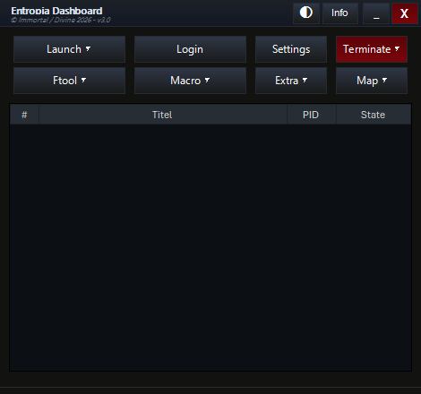
  </a>

<h3 align="center">Entropia Dashboard</h3>

<strong>Version 3.0</strong> &middot; a free, open-source Flyff multi-client companion for Windows

  
  
  
  

---

Entropia Dashboard is a free, open-source PowerShell application that takes the repetitive work out of running multiple Flyff clients. It launches and logs in your whole party, keeps profiles and settings separate, reconnects dropped clients, and bundles the tools you actually use while playing: an F-Tool, sequence macros, quick commands, notes, a market journal and the Entropia map.

The screenshots in this README use example profiles, paths and prices, and the dashboard's Custom theme - no real account or character data.

- [About](#about)
- [What's new in 3.0](#whats-new)
- [Screenshots](#screenshots)
- [Getting Started](#getting_started)
- [Features](#features)
- [Usage](#usage)
- [Built Using](#built_using)

## About 

> Main window - example clients and states

  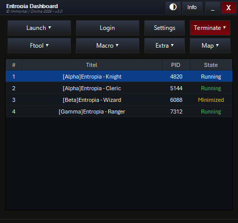

The dashboard lists every detected client with its profile, window title, PID and live state. Select one or more rows, then launch, log in, open a tool or terminate them from the same window. Right-click a row for window actions, saved positions and relog options.

The header gives you quick access to the **Theme Manager**, the project website, and the usual minimize/close controls. The main buttons follow the workflow: **Launch**, **Login**, **Settings**, **Terminate**, **Ftool**, **Macro**, **Extra** and **Map**.

## What's new in 3.0 

- **Theme Switcher & Editor** - built-in light and dark themes plus a full custom colour editor. Open it with the palette button in the title bar.
- **Market tab** - keep a local price journal, record sales, compare recent trends and optionally connect to a shared market vault.
- **Map** - interactive node maps for fields, dungeons and event maps, with search and group filters. Right-click **Map** for the Wiki.
- **Notes** - save notes, timers and reminders with due dates and notifications.
- **World Boss panel** - spawn schedule, per-boss listen toggles, one-click reporting and optional boss images.
- **Remembered clients** - every client that logs into a profile is remembered with its own reconnect, hide, F-Tool, Macro and Quick Command settings.
- **Auto-start tools** - start F-Tool, Macro Helper or a Quick Command automatically for a client once it has logged in.
- **Quick Commands** - new *Run commands on open* and *Close after run* options.
- **Smarter login coordinates** - correct default coordinates for every supported resolution, with an optional manual override per profile.
- **Editable hotkeys** - assign and edit hotkeys in Settings again, with master pause/resume bindings.
- Stability and performance fixes for low-delay macros, notifications, cancelled logins and profile repair.

## Screenshots 

### Settings

  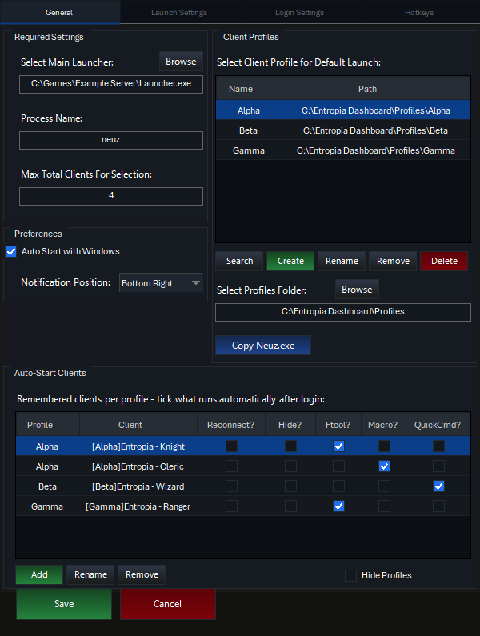
  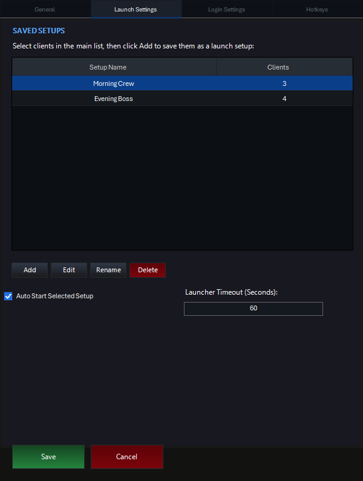

  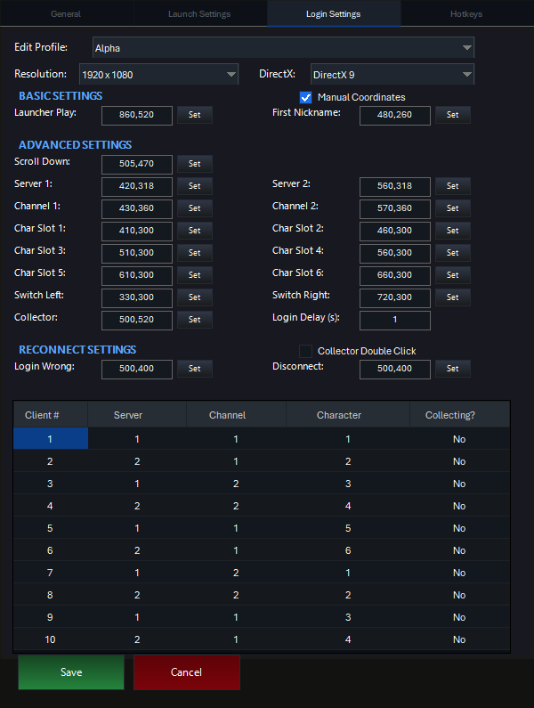
  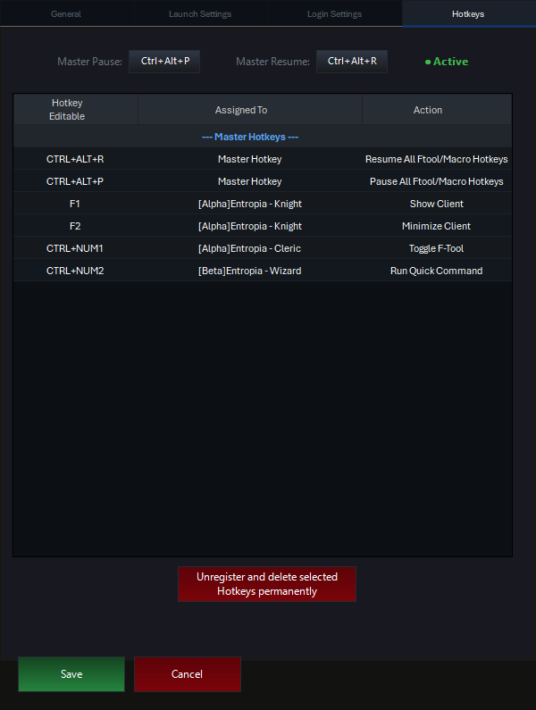

### Extra panel

  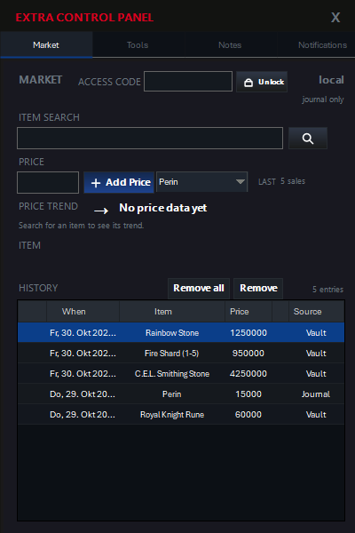
  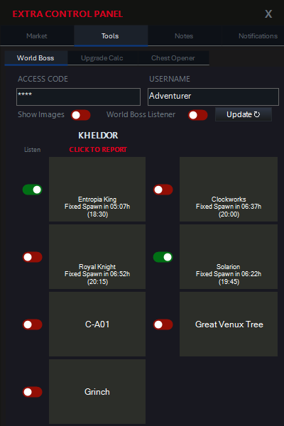
  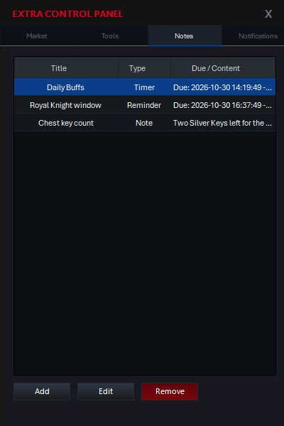

  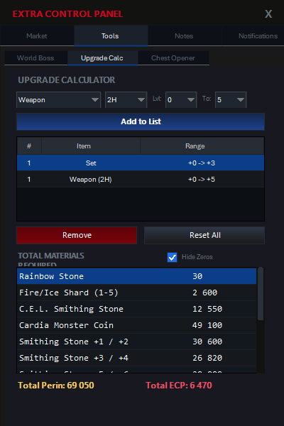
  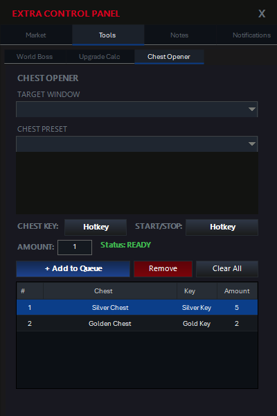
  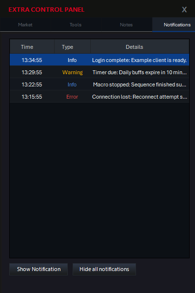

  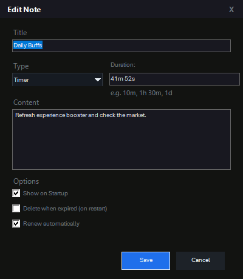

### Map and Theme Manager

  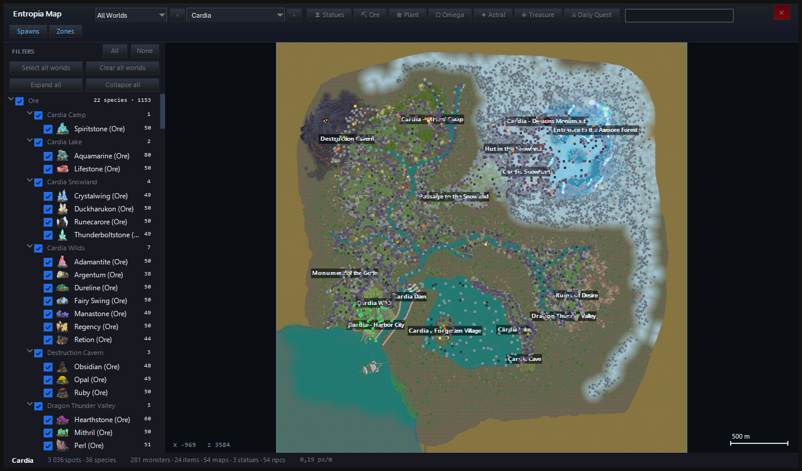

  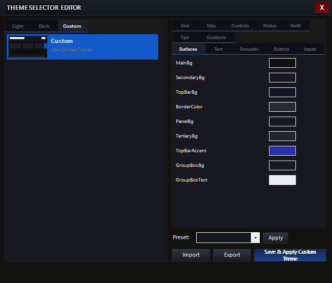

### Quick Commands and Wiki

  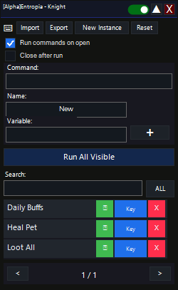

  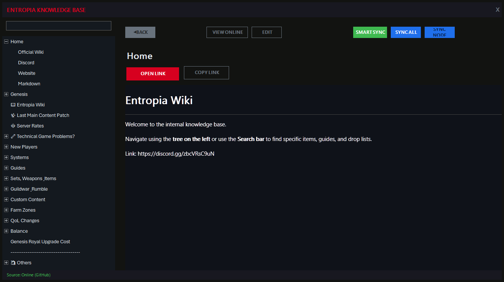

### F-Tool, Macro and Reconnect

  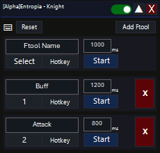
  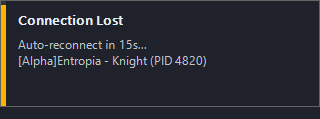

## Getting Started 

1. Download `Entropia Dashboard.exe` from the [repository](https://github.com/Immortal-Divine/Entropia_Dashboard/raw/refs/heads/main/Entropia%20Dashboard.exe) and start it. The app relaunches itself as a 32-bit administrator process - accept the prompt.
2. Open **Settings > General**, click **Browse** and select the `Launcher.exe` of your main game client. Keep the process name at `neuz` unless your server uses a different one.
3. Set the maximum number of clients, the notification corner and (optionally) autostart with Windows.
4. Create lightweight profile copies with **Create**. After patching the main client, use **Copy Neuz.exe** to update every profile.
5. In **Login Settings**, select a profile, check the resolution and coordinates, and choose the server, channel and character slot for each client. `Manual Coordinates` lets you override the calculated values.
6. Switch to **Launch Settings** to save client groups as one-click setups, and tick **Auto Start Selected Setup** if the setup should run with the dashboard.
7. Select a client and use **Launch**, **Login**, **Ftool**, **Macro** or **Extra**. In **Settings > Hotkeys** you can review, edit or remove every assigned hotkey.

> The first start opens an interactive guide. Every control also has a tooltip.

## Features 

### Process list
- Groups running clients by profile and shows the current window state (loading, normal, minimized).
- Multi-select for launch, login, terminate and tool actions.
- Detects new in-game messages and disconnects, with a flashing row indicator.
- Right-click for **Show**, **Minimize**, **Resize**, **Save/Load Position**, **Relog after Disconnect** and hotkey assignment.
- Reorder rows with the remove key; the order is used by the login nickname list.

### Launch and login
- Launches the requested number of clients without overloading the launcher.
- Right-click **Launch** for a single profile or a saved setup.
- **Login** handles the launcher Play button, nickname list, server, channel, character slot and the optional Collector start.
- Login uses the row number as the nickname position (up to 10 clients per profile).
- Moving the mouse aborts the login sequence immediately.
- Saved setups launch and log in only the missing clients of the group.

### Profiles
- Create junction-based profiles (~300 MB each) that share the base game files but keep separate in-game settings.
- Add existing folders manually, rename or remove profiles without deleting their files.
- Profiles remember their last selected client and their own login coordinates.
- Remembered clients store per-client **Reconnect?**, **Hide?**, **Ftool?**, **Macro?** and **QuickCmd?** switches.

### F-Tool
- Multiple key sequences per game window, each with its own key, interval and hotkey.
- Pins to the selected client so you can alt-tab without stopping the rotation.
- Master hotkey toggle plus a per-instance hotkey switch.
- Remembers names, intervals, keys and window position per client.

### Macro Helper and Quick Commands
- Build timed sequences with holds, waits and loops.
- Quick Commands can run on open and close themselves when the sequence finishes.
- Start either tool automatically for a client after login.

### Extra panel
- **Market** - search items, record prices, review history and trends, or unlock a shared vault with an access code.
- **Tools** - World Boss schedule with per-boss filters and report buttons, upgrade calculator and chest opener.
- **Notes** - notes, timers and reminders with due dates and notifications.
- **Notifications** - reopen past notifications and dismiss the current stack.

### Map, Wiki and themes
- **Map** opens the interactive Entropia node maps; right-click it for the Wiki.
- Built-in light/dark themes and a custom theme editor for every colour in the UI.
- Window positions are remembered, and each profile keeps its own login coordinates and selected client.

## Usage 

- **First client:** select your launcher, save, then right-click **Launch** and start one client. Log in manually once to verify the nickname list.
- **Whole party:** launch your clients, select them, save the selection as a setup and tick **Auto Start Selected Setup**.
- **Reconnect:** keep **Reconnect?** ticked for the clients that should come back after a disconnect. The dashboard waits for the disconnect dialog, logs the client back in and reports the result in a notification.
- **F-Tool:** select a client, click **Ftool**, choose a key and interval, then press **Start**. Add more sequences with **Add Ftool**.
- **Market:** open **Extra > Market**, search for an item and add a price. Prices stay in the local journal; a vault URL and access code enable shared prices.
- **Notes:** open **Extra > Notes** and add a note, timer or reminder. Due reminders appear as notifications.
- **Theme:** click the palette button in the title bar, pick a theme or edit the **Custom** colours, then save.
- **Hotkeys:** open **Settings > Hotkeys** to edit assignments, or set master pause/resume keys. The status next to them shows whether hotkeys are active.

## Built Using 

- [PowerShell 5.1](https://github.com/PowerShell/PowerShell)
- .NET Framework 4.6.2+ / Windows Forms
- Windows 10/11, 32-bit PowerShell and administrator privileges

---

  
  

  <a href="https://entropia.fun/">Entropia</a> &middot;
  <a href="https://discord.gg/zbcVRsC9uN">Divine Discord</a>

